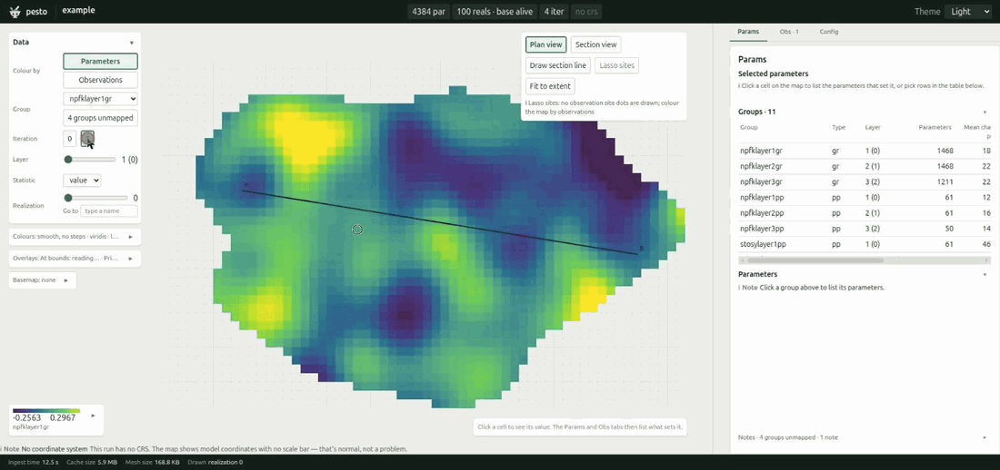

<p align="center">
  
</p>

<h1 align="center">pesto</h1>

<p align="center">
  A wannabe fast, generic, responsive viewer for PESTPP runs
</p>

<p align="center">
  <a href="https://github.com/p-ortega/pesto/actions/workflows/ci.yml"></a>
  <a href="https://github.com/p-ortega/pesto/releases"></a>
  
  
  <a href="LICENSE"></a>
  
</p>

pesto opens a finished pestpp-ies run in your browser. You get the parameter fields on the model
grid, the observations and how well they fit, and what the run was set up to do. It uses
[pyemu](https://github.com/pypest/pyemu) and [flopy](https://github.com/modflowpy/flopy) to read
the files and draws on the GPU, so moving a slider should not make you wait.

<p align="center">
  
</p>

This is an alpha. So far it has only been tried on a few MODFLOW 6 runs, so it will break on some
of yours. When it does, please [open an issue](https://github.com/p-ortega/pesto/issues).

## What you can do with it

- Colour the grid by a parameter group. Pick the iteration, layer and realization, or a statistic
  over the ensemble.
- Put the observation sites on the map and click one to see its time series, with the prior and
  the posterior.
- Look at 1:1 plots and residual histograms per observation group.
- See prior-data conflict, read from pestpp's own file.
- Draw a line on the map and cut a section along it.
- Check what the `.pst` and `.rec` say about noise, iterations and realizations.

If pesto cannot place a group on the map or cannot read a file, it tells you why. It does not
guess.

## Install

You need Python 3.11 or later. The easy way is [uv](https://docs.astral.sh/uv/), which also gets
Python for you. It is the same on macOS, Linux and Windows.

1. [Install uv](https://docs.astral.sh/uv/getting-started/installation/).
2. Install pesto:

   ```
   uv tool install https://github.com/p-ortega/pesto/releases/download/v0.1.0a1/pesto-0.1.0a1-py3-none-any.whl
   ```

pip works too, inside your own environment:

```
pip install https://github.com/p-ortega/pesto/releases/download/v0.1.0a1/pesto-0.1.0a1-py3-none-any.whl
```

## Try it

No run at hand? pesto can make a small fake one:

```
pesto --example
```

## Use it on your run

```
pesto path/to/run_folder
```

A browser tab opens. The first time, pesto reads the ensembles into a cache. That takes seconds
for a small run and a few minutes for a big one. After that the run opens right away.

Run `pesto` with no folder to pick one in the app.

The folder needs what pestpp-ies leaves behind: the `.pst`, the `.rec`, the parameter and
observation ensembles (`.jcb`, `.bin` or `.csv`) and the MODFLOW 6 binary grid file (`.grb`).

| Option | What it does |
| --- | --- |
| `--example` | Open the fake example run. |
| `--cache-dir DIR` | Keep the cache in `DIR`. |
| `--port PORT` | Use this port instead of a free one. |
| `--no-browser` | Print the address instead of opening a tab. |
| `--version` | Print the version. |

## What pesto does to your files

Nothing. It does not change them or touch their dates.

The only thing it writes is its cache. That goes in a `.pesto` folder inside the run folder. If
the folder is read-only, it goes to `~/.cache/pesto/`. To keep the run folder exactly as it is,
pass `--cache-dir`. You can delete a cache any time; pesto builds it again.

Everything stays on your machine. The server only listens on `127.0.0.1`, and pesto does not use
the internet.

## Work on it

```
git clone https://github.com/p-ortega/pesto
cd pesto
uv sync --extra test
uv run pytest -m "not slow"
```

The frontend is in `frontend/` and needs Node:

```
cd frontend
npm ci
npm test
npm run build
```

Run `npm run build` after any frontend change, or the app keeps showing the old one.

## License

BSD 3-Clause. See [LICENSE](LICENSE).
